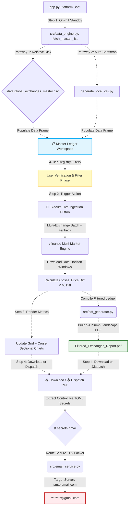

# 📊 Global Exchanges Market Performance Enterprise Workspace

A production-grade Streamlit terminal engineered to map daily market trends across global stock exchanges and benchmark indices—spanning **India (BSE & NSE)**, **USA (NYSE & NASDAQ)**, **China (SSE & SZSE)**, **Hong Kong (HKEX)**, **Singapore (SGX)**, **Japan (TSE)**, **UK (LSE)**, and **Germany (XETRA)**. This application follows a strict **Verification-First structural framework**, ensuring you can inspect and filter the base multi-exchange index registry on your desktop screen before compiling filtered ReportLab accounting ledgers and initiating downstream email operations via secure SMTP.

## About
Production-grade **Autonomous Financial Data Agent Workspace** built with **Streamlit** for **Global Stock Exchanges & Benchmark Indices** with automated reporting, filtered PDF export, and multi-exchange `yfinance` data ingestion capabilities.

### ⭐ Show Your Support

If you like the UI design, system architecture, or multi-exchange financial data engineering behind **Global Exchanges Market Performance Enterprise Workspace**, please consider giving this repository a **Star ⭐** on GitHub! It helps showcase this work and motivates future builds.


---

## 📂 System Architecture Repository Tree

```text
global-exchanges-tracker/
├── .github/
│   └── workflows/
│       └── sync_exchanges.yml          # Automated GitHub Actions cron runner
├── .streamlit/
│   └── secrets.toml                    # Encrypted enterprise SMTP credentials & target email storage
├── assets/
│   └── desktop.png                     # README desktop preview screenshot
├── data/
│   └── global_exchanges_master.csv     # Single master ledger: Country, Exchange, Index, Ticker & live prices
├── src/
│   ├── __init__.py                     # Explicit package boundary initialization
│   ├── data_engine.py                  # Multi-exchange yfinance ingestion & delta calculation engine
│   ├── email_service.py                # Secure SMTP distribution layer targeting port 587
│   └── pdf_generator.py                # Production ReportLab engine drafting filtered landscape PDFs
├── .gitignore                          # Excludes cache, temporary PDFs, and secrets
├── LICENSE                             # MIT License
├── README.md                           # System operational manual with structural Mermaid diagrams
├── app.py                              # Streamlit interface executing port 8501 runtimes
├── cron_job.py                         # Headless CLI runner for automated ingestion & email dispatch
├── generate_local_csv.py               # Baseline multi-exchange master CSV generator
└── requirements.txt                    # Python dependencies list
```

---

## 🛠️ Architecture & Core Components



---

## 🚀 Local Network Initialization

To spin up the server environment locally on port **`8501`**, execute the following sequence inside your project repository terminal:

### Boot Up the Streamlit Core Server
Run the platform using the explicit network flag to map the interface directly to port `8501`:

```bash
streamlit run app.py --server.port 8501 --server.address localhost
```

Once executed, open your desktop browser and navigate to the live deployment link:
🔗 **`http://localhost:8501`**

---

## ⚡ Operational Guidelines

1. **Phase 1 (Verification Standby):** On application boot, the global exchange registry (`Country`, `Exchange`, `Index / Benchmark Name`, `yfinance Ticker`) instantly loads onto the interactive desktop table grid. Use the cascading filters to narrow down specific countries, exchanges, or benchmark indices before running calculations.
2. **Phase 2 (Live Sync):** Select your **Start Date** and **End Date** horizon in the sidebar and click **🚀 Execute Live Ingestion**. The system ingests cross-timezone pricing via `yfinance`, computes **Previous Close**, **Last Closing Price**, **Price Difference**, and **% Difference**, paints color-coded trends (`🟢 Up` / `🔴 Down`), and renders cross-sectional performance charts.
3. **Phase 3 (Filtered Document Download & Delivery):** Click **📥 Download Filtered PDF** to save a clean 5-column landscape PDF report of your active selection locally, or click **📤 Dispatch Filtered PDF via Email** to route the report via `EnterpriseEmailService` using your hidden `secrets.toml` credentials without exposing confidential fields on-screen.

---

## ⚠️ Financial & Operational Disclaimer

For educational and research purposes only; not financial advice. Market data via `yfinance` may be delayed across international exchanges. Users must manage their own local credentials and comply with platform terms.

---

## ⭐ Support & Contribution

If you clone, test, or build upon this repository, please consider giving it a **Star (⭐)** on GitHub—it helps others discover the project and supports continued development.

* **Found a bug or have an idea?** Open an [Issue](https://github.com).
* **Want to improve the code?** Feel free to **Fork** this repository and submit a Pull Request.

* **Lead Architect & Developer:** [Srinivasta](https://github.com/SRINIVASTA)

### 🌐 Let’s Connect

[](https://www.linkedin.com/in/srinivas-t-a-557637119/)
[](https://www.kaggle.com/srinivasta)
[](mailto:tasrinivass@gmail.com)
[](https://github.com/SRINIVASTA)
[](https://srinivasta.github.io)
